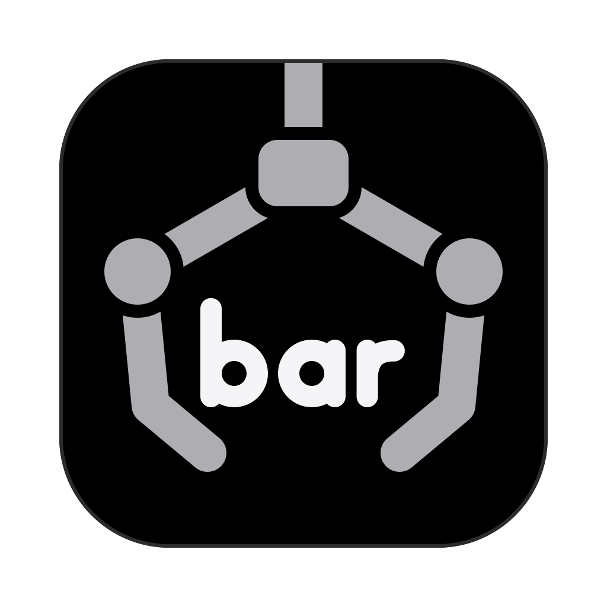
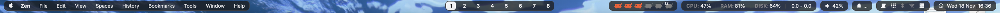
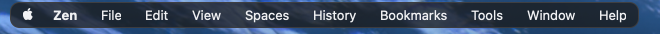
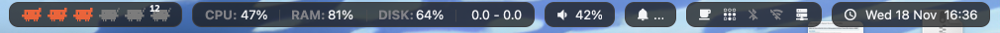
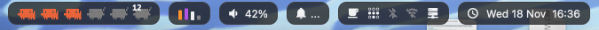
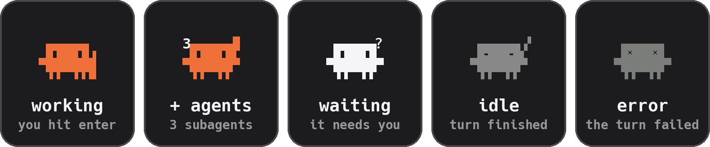

# MinBar

A macOS menu bar built on [SketchyBar](https://github.com/FelixKratz/SketchyBar): sober detached boxes
over a transparent bar, the front app's real menus on the left, AeroSpace workspaces in the middle, and
on the right system stats, a mic/camera indicator, volume, a notification bell, quick toggles, battery,
clock and [clawd](clawd/README.md), one pixel Claude Code mascot per session.



**Left**: the front app's own menus, clickable.



**Right**: clawd (one per Claude Code session: here three working, two asleep, and twelve idle for over an
hour folded into one), CPU / RAM / DISK / NET, volume, the notification bell (`...` = more than nine new),
then caffeinate, Tailscale, Bluetooth, Wi-Fi and the wired link, and the clock.



- **App menus**: the frontmost app's native menus, clickable, read through Accessibility.
- **Workspaces**: shown only when [AeroSpace](https://github.com/nikitabobko/AeroSpace) is installed.
- **Notification bell**: opens Notification Center (which a hidden menu bar otherwise makes unreachable)
  and counts what arrived since you last looked: 1–9, then `...`.
- **Controls**: caffeinate, Tailscale (when installed), Bluetooth, Wi-Fi, wired link; a right click
  opens a menu under the icon: On, Off, Settings.
- **Hides the macOS menu bar for good**, restoring it on full-screen spaces.
- **Two layouts**: `classic` for big screens, `mini` for laptops (stats as bars, slower polling).
- **One font, one weight, one size** for every text, which `minbar font-size` changes.

### Layouts

`classic` writes the system monitor out (`CPU: 47% | RAM: 81% | …`, above). `mini`, for 13"/14" screens,
draws it as four bars (CPU orange, RAM purple, DISK white, NET gray), with slower polling:



Switch with `MINBAR_VARIANT=mini` in `minbar.conf`, or try it live: `minbar layout variant mini`.

### clawd

One pixel crab per Claude Code session, acting out its state: hammering while it works, asleep when
idle, arms up when it waits on you (the box glows). Details: [clawd/README.md](clawd/README.md).



## Install

```sh
brew tap felixkratz/formulae                        # SketchyBar's tap
brew trust --formula felixkratz/formulae/sketchybar  # Homebrew's tap trust: a dependency from another tap
brew install oauramos/minbar/minbar
minbar setup                          # also offers the fonts: font-hack-nerd-font, font-sf-pro
```

`minbar setup` writes `~/.config/minbar/minbar.conf`, builds `/Applications/MinBar.app`, starts the
bar, assigns the Notification Center shortcut the bell uses (⌃⌥⌘N), offers to hide the macOS menu bar
and to install clawd's Claude Code hooks, then opens the two permission panes. Run it again any time:
every step is idempotent. If SketchyBar already runs as a brew service, stop it first
(`brew services stop sketchybar`); MinBar never touches `~/.config/sketchybar`.

Requires macOS 14.2 or later.

### Permissions, and keeping them

MinBar.app needs **Accessibility** (app menus, the bell's click), **Full Disk Access** (the bell's
count, read from macOS's notification database) and **Bluetooth** (the Bluetooth menu; macOS asks on its
own). `minbar permissions` opens the panes.

macOS ties those grants to the app's code signature. Package managers sign `sketchybar` ad hoc, so
every upgrade would drop them. Make a code-signing certificate once per Mac and MinBar signs its app
with it, so the grants survive upgrades:

```sh
minbar identity create   # asks for your password once, to trust the certificate
minbar app --restart
```

After `brew upgrade minbar` or `brew upgrade sketchybar`, run `minbar restart`.

## Use

`minbar doctor` checks the install from inside the running bar (the permissions are the bar's, not your
terminal's):

```
  ✓ daemon running (pid 4301, launchd com.github.oauramos.minbar)
  ✓ MinBar.app current (signed by MinBar Code Signing)
  ✓ Accessibility granted (app menus, the bell's click)
  ✓ Full Disk Access granted (the bell's count)
  ✓ Bluetooth granted (the Bluetooth menu)
  ✓ fonts installed
  ✓ workspace pill follows AeroSpace (workspace 1)
  ✓ native menu bar hidden (menubar-alpha running)
  ✓ mic/camera indicator watching (off)
  ✓ clawd hooks in ~/.claude/settings.json
```

```
minbar                            interactive menu
minbar doctor                     daemon, permissions, fonts, AeroSpace, helpers, clawd's hooks
minbar status
minbar reload | restart | hide | show
minbar toggle caffeine|wifi|bluetooth|tailscale|mute
minbar volume 40
minbar font-size 14               every text on the bar, 10 to 16 (also +, -, reset)
minbar layout variant mini        runtime overrides of minbar.conf; `minbar layout reset` undoes them
minbar layout stats off
minbar workspaces                 how many pills, and where each app opens
minbar workspaces count 6
minbar workspaces set Slack 5     its new windows open on 5; `dynamic` undoes it
minbar clawd 6                    clawds shown before +K
minbar native-bar show|hide       the macOS menu bar
minbar preview ~/src/minbar       run a checkout's bar live
minbar --query bar                anything starting with - goes to sketchybar
```

## Configure

`~/.config/minbar/minbar.conf`, plain `KEY=value` lines, then `minbar reload`:

| Key | Default | |
|---|---|---|
| `MINBAR_VARIANT` | `classic` | `classic` or `mini` |
| `MINBAR_FONT_SIZE` | `13` | every text on the bar, 10 to 16 points; the icons follow (`minbar font-size` overrides it) |
| `MINBAR_SHOW_STATS` | `1` | the CPU / RAM / DISK box |
| `MINBAR_SHOW_NETWORK` | `1` | NET in it |
| `MINBAR_SHOW_WIFI_NAME` | `0` | the SSID next to the Wi-Fi glyph |
| `MINBAR_WORKSPACES` | `auto` | AeroSpace workspaces when installed; `off` hides them |
| `MINBAR_WORKSPACE_COUNT` | 8 (5 on mini) | workspace pills (`minbar workspaces count` overrides it) |
| `MINBAR_CLAWD` | `on` | clawd |
| `MINBAR_NC_KEY` / `MINBAR_NC_MODS` | `45` / `ctrl,alt,cmd` | the Notification Center shortcut (⌃⌥⌘N); `minbar hotkey set` after a change |
| `MINBAR_HIDE_NATIVE_BAR` | `1` | hide the macOS menu bar (`minbar setup` applies it) |
| `MINBAR_SIGNING_IDENTITY` | `MinBar Code Signing` | the certificate the app is signed with |
| `MINBAR_APP_DIR` | `/Applications` | where MinBar.app goes (`~/Applications` when `/Applications` is not writable) |

`CLAWD_*` lines style clawd (every key: [clawd/README.md](clawd/README.md)). Colours, fonts and spacing
live in `bar/theme.sh`.

### AeroSpace

With AeroSpace installed, the workspaces appear by themselves. To light the focused one, add to
`~/.aerospace.toml`:

```toml
exec-on-workspace-change = ['/bin/bash', '-c',
  'sketchybar --trigger aerospace_workspace_change FOCUSED_WORKSPACE=$AEROSPACE_FOCUSED_WORKSPACE']
```

and match `persistent-workspaces` to `MINBAR_WORKSPACE_COUNT`. Leave about 42 px of top gap
(`gaps.outer.top`) so windows clear the bar.

### App workspaces

An app opens where you are (dynamic) unless it has a workspace of its own. Set it from `minbar` ›
Workspaces, with a right click on a workspace number (the front app), or:

```sh
minbar workspaces set Slack 5
minbar workspaces set Playwright=com.google.Chrome,com.google.chrome.for.testing 8   # several apps, one name
minbar workspaces set Playwright dynamic
minbar workspaces reset
```

New windows move there without taking the focus; open ones stay. The same rules as settings, one per
line in `~/.config/minbar/workspaces.conf`:

```
Playwright = com.google.Chrome, com.google.chrome.for.testing -> 8
com.apple.mail -> 3
```

or `programs.minbar.workspaces.apps` in Nix. `~/.aerospace.toml` is not touched: a launchd agent follows
AeroSpace's window events, so this needs AeroSpace 0.21 or later (and `minbar agents install` after
upgrading from 0.1). A rule here wins over an `on-window-detected` one for the same app.

### Tailscale

The toggle runs `tailscale up` / `down`, which needs no sudo once you logged in with
`sudo tailscale up --operator=$USER`.

## Nix (home-manager)

```nix
inputs.minbar.url = "github:oauramos/minbar";
# …
home-manager.sharedModules = [ inputs.minbar.homeManagerModules.default ];
programs.minbar = {
  enable = true;
  variant = "mini";
  extraPath = [ "/opt/homebrew/bin" ];  # where aerospace / tailscale live
};
```

The module writes `minbar.conf`, declares the launchd agents and runs the setup steps on activation. The
helpers link the private SkyLight framework, so builds need the Nix sandbox off (nix-darwin's default on
macOS). Grant the permissions and create the certificate once, as above.

## Uninstall

```sh
minbar uninstall
brew uninstall minbar
```

## Build from source

```sh
make                 # helpers into build/bin, the Simple Icons font into fonts/
bin/minbar help      # runs from the checkout
make check           # shellcheck
scripts/privacy-check.sh
```

## Credits

MinBar runs [SketchyBar](https://github.com/FelixKratz/SketchyBar) by Felix Kratz, unmodified.
`helpers/menus` comes from [Felix Kratz's dotfiles](https://github.com/FelixKratz/dotfiles);
`menubar-alpha` makes the same SkyLight call as [yabai](https://github.com/koekeishiya/yabai)'s
`menubar_opacity`. Licenses and the rest: [NOTICE.md](NOTICE.md). MinBar is GPL-3.0; clawd keeps its
MIT license.
